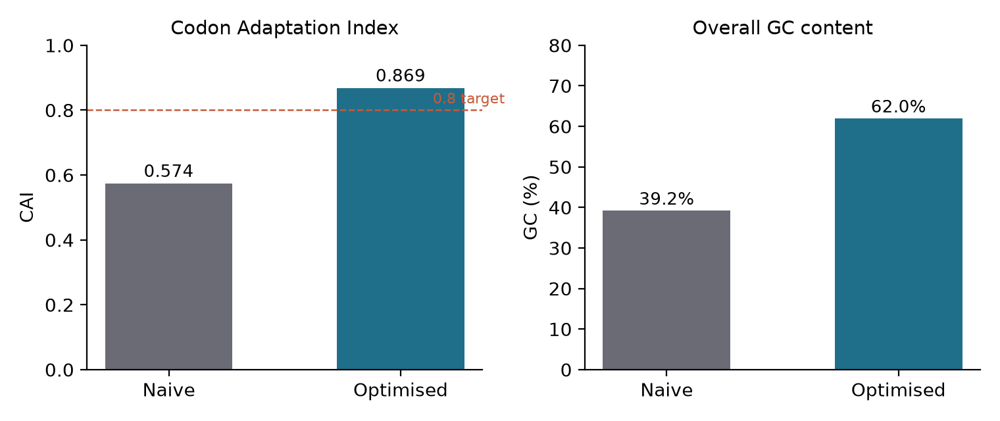
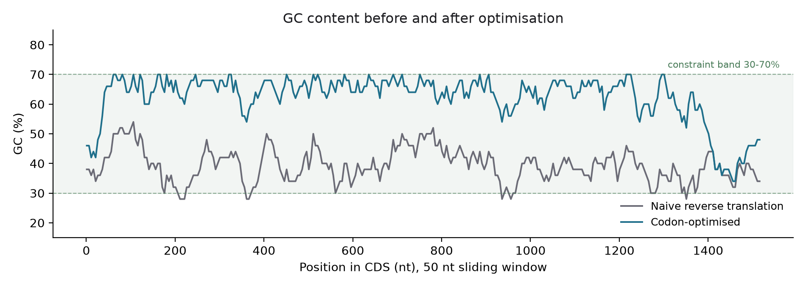

# Design of a codon-optimised RsTAL expression construct in pET-28a(+)

*In-silico design only. Nothing in this document has been built or tested at the bench.*

## 1. What this is and why TAL

Tyrosine ammonia-lyase converts L-tyrosine into p-coumaric acid. That reaction is
the gateway into the phenylpropanoid pathway, which is where most plant
polyphenols, flavonoids and stilbenes come from. Any attempt to make those
compounds in a microbe starts with getting an ammonia-lyase to work in
*E. coli*, so TAL is a sensible first target rather than an arbitrary one.

The enzyme used here is the *Rhodobacter sphaeroides* enzyme (RsTAL,
UniProt Q3IWB0), chosen because it is structurally characterised: there are
crystal structures of the wild type bound to p-coumarate and of the H89F
variant, which gives a published reference point for later variant work.

**Target protein:** 523 aa
**Provenance:** UniProtKB/Swiss-Prot Q3IWB0 (), sequence version 1

## 2. A sequence trap worth recording

The crystallographic chain is 521 residues, but one of those positions is not a
standard amino acid: it is MDO, the 4-methylideneimidazole-5-one (MIO)
prosthetic group, whose parent residues are Ala-Ser-Gly.

MIO is not added by the cell. It forms autocatalytically from the enzyme's own
backbone at that triad. So the gene has to encode Ala-Ser-Gly there, and the
coding sequence is 523 residues, not 521. Taking the
structural chain at face value would mean ordering a gene with a two-residue
deletion in the middle of the catalytic centre, and the protein would express
and purify perfectly well while being completely dead.

## 3. Codon optimisation

Reverse translation and optimisation were done with DNA Chisel against the
Kazusa *E. coli* K-12 codon usage table, with forbidden restriction sites
treated as hard constraints in the same solve.

Doing it in one solve matters. Optimise first and strip sites afterwards and you
can reintroduce a rare codon; strip sites first and then optimise and you can
recreate the site.

| Metric | Naive | Optimised |
|---|---|---|
| Length (nt) | 1569 | 1569 |
| CAI | 0.574 | 0.869 |
| GC (%) | 39.2 | 62.0 |
| Min 50 nt window GC (%) | 28 | 34 |
| Max 50 nt window GC (%) | 52 | 70 |
| Classic rare codons | 0 | 0 |

Constraints applied:

- translation identical to the input protein (hard)
- no NdeI, XhoI, NcoI, NheI, BamHI, EcoRI, SacI, SalI, HindIII, NotI or EcoRV site
- GC within 30-70% in every 50 nt window, and 35-62% overall
- **5' ramp:** GC held to 25-50% across the first 15 codons
- **primer-binding windows:** no short hairpins in the first or last 60 nt; GC 45-62% across the last 45 nt

The 5' ramp is the constraint that is easiest to leave out and most expensive to
get wrong. A stable hairpin over the ribosome binding site and start codon blocks
translation initiation, and naively maximising CAI makes this *worse* for a
protein from a high-GC organism, because the preferred codons are themselves
GC-rich. The GC trace shows the deliberate dip at the 5' end.

Overall GC lands at 62%, which is high. That is a property of
the protein, not a failure of the optimiser: RsTAL comes from a high-GC organism
and is rich in Ala, Arg, Gly and Pro, whose *E. coli*-preferred codons are
GC-rich. Pushing GC lower would mean giving up CAI.





Forbidden sites remaining in the optimised insert: **none**

## 4. Vector, cloning strategy, and what actually gets expressed

**Vector:** pET-28a(+), 5,369 bp. T7 promoter for high-level expression, *lac*
operator for IPTG induction, His6 for single-step IMAC, kanamycin resistance
(more stable in long cultures than ampicillin, where secreted beta-lactamase
degrades the drug and lets untransformed cells grow).

**Strategy:** NdeI / XhoI, stop codon omitted.

### Two things the real vector sequence settled

**The cassette is stored on the bottom strand.** In the SnapGene distribution of
pET-28a(+), the T7 promoter, start codon and MCS run in *decreasing* coordinates:
XhoI is at 159 and NdeI at 239. Digesting the stored strand as written would
insert the gene backwards, and every frame check would still pass, because the
arithmetic would be internally consistent. The pipeline detects the orientation
from the T7 promoter and reverse-complements before cutting.

**NdeI does not remove the N-terminal tag.** This is the opposite of what is
often assumed. The relevant stretch of pET-28a(+) reads:

```
AAGGAGATATACC ATG GGC AGC AGC CAT CAT CAT CAT CAT CAC AGC AGC GGC
              M   G   S   S   H   H   H   H   H   H   S   S   G
              CTG GTG CCG CGC GGC AGC CAT ATG
              L   V   P   R   G   S   H   M  <- the NdeI ATG
```

The NdeI site sits **downstream** of the His6 and thrombin site and **in frame**
with the vector's own start codon, which is the one the ribosome binding site
serves. So the product carries the N-terminal leader as well as the C-terminal
tag. Cloning into **NcoI** is what removes the N-terminal tag, and that is not
available here without mutating residue 2, since NcoI (CCATGG) requires the
second codon to begin with G and RsTAL residue 2 is Leu.

### The expressed product

| Property | Value |
|---|---|
| Length | 551 aa |
| Composition | 20 aa leader + 523 aa RsTAL + LEHHHHHH |
| N-terminal leader | `MGSSHHHHHHSSGLVPRGSH` |
| C-terminal tail | `LEHHHHHH` |
| Predicted mass | 58.1 kDa (untagged RsTAL is 54.9 kDa) |

The leader is a mixed blessing. Earlier in the design I wanted to keep bulk away
from the N-terminus, because the MIO group forms within the protein's own chain
and an N-terminal extension sits closer to it than a C-terminal one. Twenty extra
residues is not nothing.

What makes it acceptable is the thrombin site in the middle of the leader.
Cleaving after LVPR removes the His6 and leaves GSHM ahead of the native
sequence, so the N-terminal bulk is removable after purification rather than
permanent. The two tags also give two independent purification handles, which is
useful when you do not yet know whether the protein behaves.

If expression or activity disappoints, the comparison to run is this construct
against an NcoI/XhoI version carrying an L2V substitution, which trades a
conservative point mutation for a clean N-terminus.

## 5. Primers

| Name | Sequence (5'->3') | Length | Anneal Tm (C) | Anneal GC (%) | Hairpin dG (kcal/mol) | Self-dimer dG (kcal/mol) | Warnings |
|---|---|---|---|---|---|---|---|
| RsTAL_NdeI_F | GGAATTCATATGCTGGCGATGAGCCCACCAAAAC | 34 | 64.5 | 59.0 | -2.3 | -5.1 | none |
| RsTAL_XhoI_R | CGCGGCCTCGAGAACTGGAGACTGCTGTAACAAATGG | 37 | 61.5 | 44.0 | -0.9 | -5.7 | none |
| RsTAL_seq_F1 | TATCTGATCTGCGCCCACATC | 21 | 60.0 | 52.0 | 0.0 | -5.9 | none |
| RsTAL_seq_F2 | CGTCCATTAGGTCAAGAAATCGC | 23 | 60.0 | 48.0 | 0.1 | -2.0 | none |
| T7_promoter | TAATACGACTCACTATAGGG | 20 | 50.3 | 40.0 | 0.0 | -4.5 | none |
| T7_terminator | GCTAGTTATTGCTCAGCGG | 19 | 56.2 | 53.0 | 0.0 | -3.2 | none |

Two notes on how these numbers were produced.

Tm is the nearest-neighbour calculation from primer3, not the
4*(G+C) + 2*(A+T) rule, which is badly wrong above about 20 nt. For a primer
carrying a restriction tail, the Tm that governs the first PCR cycle is the Tm
of the **annealing portion only**, because the tail has nothing to anneal to
yet. That is the figure tabulated above, and the one to set the annealing
temperature from.

Secondary structure is judged on free energy, not melting temperature. primer3
reports a hairpin Tm that can look alarming for a 3 bp stem whose dG is only
about -2 kcal/mol, a structure that never forms at annealing temperature.
Thresholds here are dG < -3 kcal/mol for hairpins and dG < -6 kcal/mol for
dimers.

Cloning pair heterodimer dG: **-4.56 kcal/mol**.

Each cloning primer carries a 6 base clamp 5' of the restriction site, because
most enzymes cut poorly at the very end of a fragment. The clamp sequence was
chosen by searching candidates and scoring them, not fixed in advance.

## 6. In-silico verification

Simulated build: amplicon 1590 bp, digested insert
1571 bp, final plasmid 6862 bp.

| Check | Result | Detail |
|---|---|---|
| Translational start | PASS | ribosome starts 60 bp upstream of the insert ATG, in frame; leader is 'MGSSHHHHHHSSGLVPRGSH' (vector N-terminal His6 + thrombin site, retained by NdeI cloning) |
| Insert translation | PASS | 523 aa, identical to the UniProt sequence |
| Full expressed product | PASS | 551 aa = 20 aa leader + 523 aa RsTAL + LEHHHHHH |
| No premature stop | PASS | no stop codon within the insert reading frame |
| His tag in frame | PASS | His6 DNA at position 1576, offset 0 from frame; present in the translated ORF before the first stop |
| 5' junction (NdeI) | PASS | CATATG reconstituted across the origin: ...CAT | ATG... |
| 3' junction (XhoI) | PASS | XhoI site at base 1570, immediately after the last insert codon, frame offset 0 (0 = Leu-Glu reads in frame into the tag) |
| Plasmid size | PASS | 6862 bp = vector 5369 bp - stuffer 78 bp + insert CDS 1569 bp + 2 bp (the CA of the reconstituted NdeI site and the C of the XhoI site) |

**8 of 8 checks passed.**

The NdeI check is the one that catches real errors. NdeI leaves a TA overhang,
so the digested insert begins `TATG` and the backbone ends `CA`: the start codon
only exists once the two are ligated. The check confirms CATATG is actually
reconstituted rather than assuming it.

## 7. Confirmation plan for the bench

| Step | Method | Expectation |
|---|---|---|
| Insert present | Colony PCR with the cloning primers | Product at ~1590 bp; empty vector gives no product or a much smaller one |
| Orientation and size | Diagnostic digest, NdeI + XhoI | Two bands: insert ~1571 bp and backbone |
| Sequence | Sanger from T7 promoter and T7 terminator primers, plus the internal primers above | Full coverage; reads overlap |
| Expression | BL21(DE3), IPTG induction, SDS-PAGE | Band near the predicted mass |
| Activity | p-coumarate absorbance near 310 nm | Rate above the empty-vector control |

Sanger reads give roughly 700-900 clean bases, which is why internal primers are
needed: the T7 primers alone cannot cover a 1569 bp insert.

## 8. Limitations

- Design only. Nothing here has been synthesised, cloned, expressed or assayed.
- Codon optimisation predicts expression; it does not guarantee it. CAI correlates with expression across genes, but is a weak predictor for any single gene.
- Solubility was not modelled. Ammonia-lyases of this family are large and homotetrameric, and inclusion bodies are a realistic outcome.
- The hairpin and dimer calculations are two-state thermodynamic models, not a simulation of what happens in a PCR tube.
- The 5' ramp constraint is based on an established principle, but the specific window used here (15 codons, 25-50% GC) is a reasonable default, not a value optimised for this gene.
- No experimental validation of the MIO triad assignment beyond the structural annotation.

## 9. Reproducing this

```bash
pip install biopython python_codon_tables dnachisel primer3-py pandas matplotlib
python3 scripts/run_all.py --protein data/Q3IWB0.fasta --vector data/pET-28a.gb --seed 1
```

DNA Chisel's solver is stochastic, so the run is seeded. Seed **1**
reproduces every sequence, primer and coordinate in this document exactly.

## References

- Watts KT, Mijts BN, Lee PC, Manning AJ, Schmidt-Dannert C. Discovery of a substrate selectivity switch in tyrosine ammonia-lyase. *Chem Biol* 2006;13:1317-26. PMID 17185227
- Louie GV, Bowman ME, Moffitt MC, Baiga TJ, Moore BS, Noel JP. Structural determinants and modulation of substrate specificity in phenylalanine-tyrosine ammonia-lyases. *Chem Biol* 2006;13:1327-38. PMID 17185228. PDB 2O6Y, 2O78, 2O7B, 2O7D, 2O7E, 2O7F
- Sharp PM, Li WH. The codon adaptation index. *Nucleic Acids Res* 1987;15:1281-95
- Zulkower V, Rosser S. DNA Chisel, a versatile sequence optimizer. *Bioinformatics* 2020
- Untergasser A et al. Primer3, new capabilities and interfaces. *Nucleic Acids Res* 2012;40:e115
